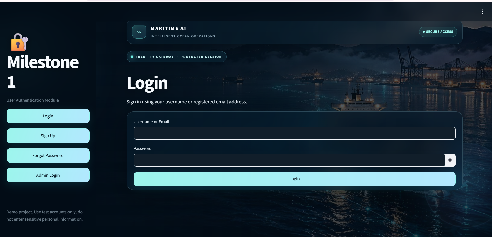
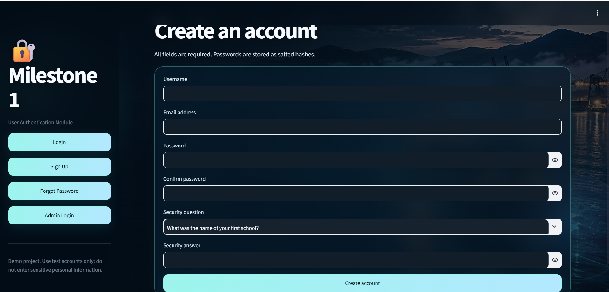
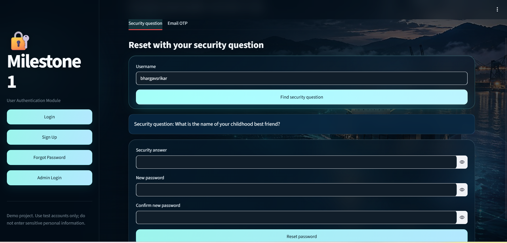
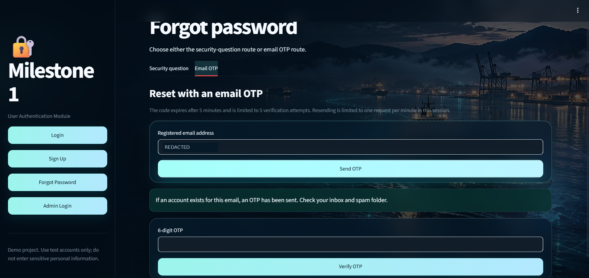
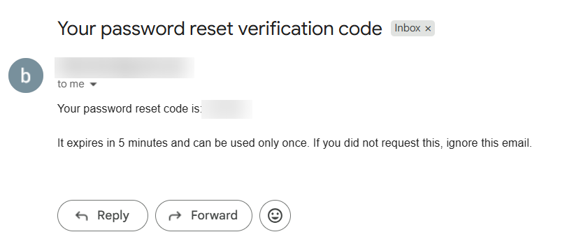
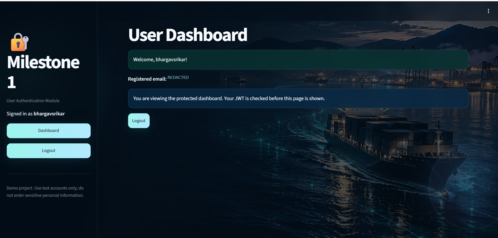
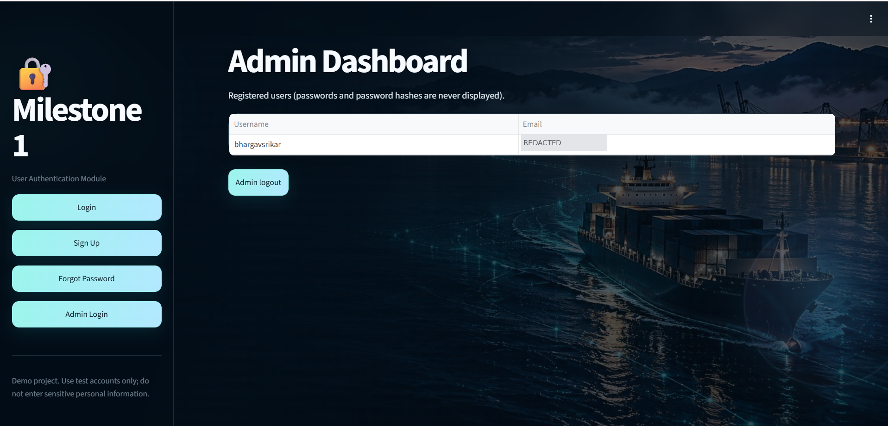

# Infosys Springboard Internship 7.0 — Batch 4 — Milestone 1

## User Authentication Module

Milestone 1 is a Streamlit application that provides secure user registration and login, password recovery, a protected user dashboard, and a separate administrator dashboard. The app is designed to run in Google Colab and is exposed publicly for the demo through an ngrok tunnel.

## Features

- **Login:** accepts username or registered email and password. Failed login displays a generic error rather than revealing whether the username or password was incorrect.
- **Signup:** collects username, email, password, confirmation, a security question selected from a fixed list, and a security answer. Duplicate usernames and email addresses are rejected.
- **Input validation:** required fields, the assignment's email-format rule, password length and complexity, and exact password confirmation are checked.
- **Password storage:** passwords and security answers are stored as salted PBKDF2-HMAC-SHA256 hashes (260,000 iterations in this version), not plaintext.
- **JWT session:** successful user login issues an HS256-signed JWT with a 60-minute lifetime. The protected User Dashboard checks the token before showing account details.
- **Forgot Password:** supports both security-question recovery and Gmail email OTP recovery. The OTP expires after five minutes, is one-time use, has limited verification attempts, and has a resend cooldown.
- **User Dashboard:** displays a welcome message and registered email and provides Logout.
- **Admin Dashboard:** uses a separate administrator account, distinct from public signup accounts. It lists registered usernames and email addresses, never passwords or password hashes.

## Technology stack

- Python
- Streamlit
- PyJWT for JSON Web Token signing and verification
- PBKDF2-HMAC-SHA256 from Python's `hashlib` for password and security-answer hashing
- Google Colab and Colab Secrets for runtime configuration
- pyngrok/ngrok for public access to the Streamlit server
- Gmail SMTP over SSL (`smtp.gmail.com:465`) for OTP delivery
- JSON file storage for this educational demonstration

## Colab Secrets

Create the following secrets in the Google Colab Secrets panel and enable notebook access for each one. The notebook reads the values at runtime; do not paste secret values into code or commit them to GitHub.

| Secret | Purpose |
|---|---|
| `JWT_SECRET` | JWT signing key; at least 32 characters |
| `NGROK_AUTHTOKEN` | ngrok authentication token |
| `EMAIL_ADDRESS` | Gmail address used as the OTP sender |
| `EMAIL_PASSWORD` | Gmail App Password (not the normal Gmail password) |
| `ADMIN_USERNAME` | Separate administrator username |
| `ADMIN_PASSWORD` | Strong administrator password |

The Admin account remains separate from signup accounts. Its credentials are read from Colab Secrets rather than hard-coded in the submitted source, so the real password is not exposed in the public notebook.

## How to run in Google Colab

1. Open `Infosys_Milestone1_Authentication.ipynb` in Google Colab.
2. Add the six Colab Secrets listed above and turn on notebook access for each.
3. Select **Runtime → Run all**. The notebook installs Streamlit, PyJWT and pyngrok, writes the embedded application to `/content/app.py`, starts Streamlit on port `8501`, and opens an ngrok tunnel.
4. Open the ngrok URL printed by the launch cell. Keep the Colab runtime running while using the app.
5. Test signup, login, both password-recovery routes, the User Dashboard/logout, and the separate Admin login/dashboard.
6. After testing, run the notebook cleanup cell to stop the Streamlit process and ngrok tunnel.

## Screenshots

The following screenshots were supplied by the project owner and are stored in `Milestone1/screenshots/`. The Gmail OTP and account email fields have been blurred for privacy before being added to this public repository.

### Login

### Signup

### Forgot Password — Security Question

### Forgot Password — Email OTP

### Gmail OTP Email Received

### User Dashboard

### Admin Dashboard

## Demo limitations and security notes

- User records are stored in `/content/infosys_milestone1_users.json` inside the active Colab runtime. This is temporary demo storage and may be lost when the runtime is reset or deleted.
- The ngrok URL is public to anyone who has the link while the tunnel is running. Use test accounts only and stop the tunnel after testing.
- A JWT is signed, not encrypted. Never put passwords or secret values in the token payload.
- Do not commit Colab secret values, OTPs, tokens, logs, or the runtime JSON user database.

## Final submission checklist

- [x] Infosys repository contains a `Milestone1` folder.
- [x] `Milestone1/README.md` explains the milestone, features, technology stack, and run instructions.
- [x] Login, signup, and Forgot Password pages are implemented.
- [x] JWT session handling is implemented.
- [x] Required-field, email-format, and password validation are implemented.
- [x] Security-question and Gmail OTP recovery routes are implemented; the owner confirmed both reset-and-login flows work.
- [x] User Dashboard and separate Admin Dashboard are implemented.
- [x] ngrok, Gmail, JWT and Admin credentials are read from Colab Secrets.
- [x] Required screenshots are included and linked above.
- [x] Notebook outputs and execution counts are cleared in the submission copy.
- [x] Notebook source contains Colab-Secrets lookups rather than hard-coded secret values.
- [ ] After uploading, re-open the notebook in Colab and perform one final clean top-to-bottom run with the owner's Colab Secrets.
