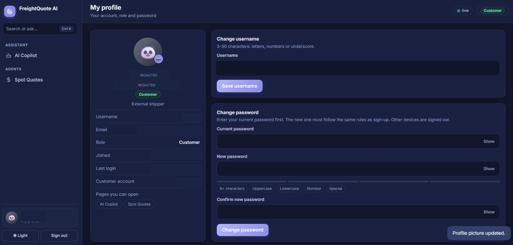

# Milestone 2 screenshots only

These 10 JPEGs are copied from the `Milestone2/screenshots/` directory of the team's Mehak repository. **Only Milestone 2 screenshots are included. No images from `Milestone1/` are included.** They have been sanitized before inclusion: account emails and usernames, customer/account identifiers, account activity timestamps, the quote reference and revenue amount are hidden; a personal profile photograph was replaced with a generic silhouette. The sign-in screenshot had no entered credentials.

## Screenshot gallery

| Screenshot | Evidence |
|---|---|
| [Login Page](Login%20Page.jpeg) | Shared login page |
| [Admin Dashboard](Admin%20Dashboard.jpeg) | Admin dashboard and users table |
| [Admin Profile](Admin%20Profile.jpeg) | Admin profile and account settings |
| [Admin AI Copilot](Admin%28AI%20Copilot%29.jpeg) | Admin SQL Copilot answer/table view |
| [Operations Manager AI Copilot](Operations%20Manager%28AI%20Copilot%29.jpeg) | Operations Manager Copilot view |
| [Operations Manager Profile](Operations%20Manager%28Profile%29.jpeg) | Operations Manager profile |
| [Freight Broker](Freight%20Broker.jpeg) | Freight Broker margin dashboard |
| [Auditor Spot Quotes](Auditor%28Spots%20Quotes%29.jpeg) | Auditor's read-only Spot Quotes view |
| [Auditor Profile](Auditor%28Profile%29.jpeg) | Auditor profile |
| [Customer](Customer.jpeg) | Customer profile and customer navigation |

### Visual preview

**Login Page**

**Admin Dashboard**

**Admin Profile**

**Admin AI Copilot**

**Operations Manager AI Copilot**

**Operations Manager Profile**

**Freight Broker**

**Auditor Spot Quotes**

**Auditor Profile**

**Customer**

## Instructor evidence checklist

The screenshots available in Mehak's Milestone 2 folder cover some, but not all, requested evidence. Do not mark the missing items as completed until they are captured from the working app.

| Requested evidence | Status in the 10 supplied screenshots |
|---|---|
| Login page | Available |
| Signup form | No separate capture |
| Profile page | Available (Admin, Operations Manager, Auditor, Customer) |
| Admin dashboard with users table | Available |
| Restricted action returning HTTP `403` | Not shown |
| Role matrix in README | Documented in `../README.md` |
| Copilot exact/database answer | Admin Copilot answer view available; verify visible query/SQL detail before relying on it as exact-answer evidence |
| Copilot greeting | Not shown |
| Generated quote | Not clearly shown as a generated quote |
| Weather page after a storm | Not shown |

Capture the missing screens from the running project before treating the evidence set as complete.
